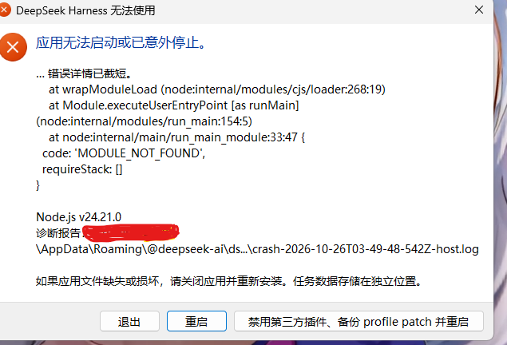

# ⚡ dsh-power-switch · 一键电源开关 🐋

> 右上角多一枚电源键 🔘
> 点一下，DSH 进程**真的没了** 💀；再点一下，它**真的又爬起来了** 🧟
>
> 不是 `location.reload()` 🙅 不是 `router.refresh()` 🙅 更不是「转两圈假装重启好了」那种糊弄学 🎭
> 是这个进程真的从任务管理器里消失，然后一个新的它站起来 💪

---

## 😩 这玩意儿到底救你于什么水火

装插件 🧩、改配置 ⚙️、调 patch 🩹 之后，DSH 十次有八次来一句：「重启一下才生效哦～」

然后你就开始了这套祖传行为艺术 🎪：

1. 🔍 翻到任务管理器
2. 🎲 在一堆 `node.exe` 里猜哪个是 DSH（纯玄学）
3. 💥 猜错一次，把别的东西干掉了
4. 😌 猜对一次，关掉
5. 🧠 忘了刚才的命令行是什么，凭记忆重敲
6. 🚫 端口被占，报错
7. 🌐 重开一个终端，`dsh web`，端口又变了，浏览器地址失效

一套下来十五分钟没了，插件还没生效 🙃

`dsh-power-switch` 把这一整套压缩成**两次点击** 👆👆（第二次是防误触，它有点礼貌，不是啰嗦）

---

## 👀 长什么样

会话头部右侧多一枚小电源图标 ⚡，**不抢位置**、**不遮**最小化 ➖ / 隐藏 👻 / 关闭 ❌ 那组窗口按钮（这点我盯得很死，谁也别想挤到它们）

点开是个小菜单，里面**只有两个按钮**，干干净净：

| 按钮 | 干了什么 |
| --- | --- |
| **⚡ 重启** | 结束当前进程 → 等端口让出来 → 按**原来的命令行**重新拉起一份 🔁 |
| **⏻ 关闭** | 结束当前进程，不自动拉起 🌙 |

两个按钮都要**点两次** 👆👆：
第一次是「你真的想好了吗 🤨」，第二次才是「好，动手 🔨」

---

## ⚠️ 重启时弹「应用无法启动或已意外停止」——这是正常的！别慌！

点重启后，屏幕上会跳出这么一个吓人的窗口 😱：



**🫂 别慌，这是正常情况，不是坏了。**

原因贼直白 🧾：这插件的重启就是**真的把进程杀了** 🔪
DSH Desktop 的外壳发现自己怀里的宿主进程突然没了 💀，就尽职尽责地报了一次崩溃 ——
它不知道这是你亲手按的电源键，它只知道自己被杀了 🥲 所以它弹窗、写崩溃日志，然后安安静静等着。

紧接着，插件早就留好的那个 helper 进程 🤖 会把新的一份拉起来 🐣
等服务端口重新监听上，页面自己刷新，一切照旧 ✨

完整流程长这样 👇

1. 点「⚡ 重启」👆
2. 弹这个窗 → **正常** ✅ 说明进程真的死了（这是生效的证据！）
3. ⛔ **别点**「退出」，**别点**「重启」（点了就变成两次重启了，会打架），让它待着或者直接关掉这个窗
4. ⏳ 几秒到十几秒，DSH 自己回来
5. 🔄 页面自动刷新，继续用

窗口里那句 `MODULE_NOT_FOUND` 也是同一个道理 🧩：崩溃报告要写堆栈，而它被中断在启动早期，写出来就是这串。
**它真不是你插件坏了** 🙏 是「进程被突然打断」这件事本身的副产品。

> 💡 不想看到这个弹窗？那就用「⏻ 关闭」—— 关闭是你主动要它走，DSH 会安静退出 😴
> 只有「重启」这种「先死一次再复活」的操作 🧟，外壳才会误以为出事了。

---

## 🛠️ 它是怎么「真的」重启的（技术党进）

没有魔法 ✨ 只有三段：

1. **自省** 🪞：从 `process.execPath` / `process.argv` / `process.execArgv` 现场问出「我是被谁、用什么命令启动的」
   - Electron 宿主 → 重放 `execPath + argv.slice(1)`
   - 普通 node 宿主 → 拼回 `node + execArgv + 入口 + 参数`
   - **不猜** profile 🙅 **不读**别人的配置文件 🙅 **不写死**路径 🙅
2. **接力** 🏃：拉起一个 `detached` 的 helper 进程。它不在宿主进程树里 🌳 所以宿主退出时它不会被连坐 🛡️
3. **交接** 🤝：宿主退出 → helper 等端口释放 → 拉起新进程 → helper 自己也退出 👋

关闭更简单 😴：给 launcher 的 `appExit` 钩子打个招呼；没有钩子就直接 `process.exit(0)`

**关于端口** 🔌：新进程起来后端口可能跟原来不一样（DSH 会自己挑），所以重启完是**等 ping 通就刷新页面**，而不是死守旧地址 🎯

---

## 📦 安装

插件市场里搜 **电源** 🔌 / **power** ⚡，或者：

```bash
dsh plugin add dsh-power-switch
```

装完重启一次 DSH（对，就用它自己 😏 第一次得手动，之后就不用受这罪了）

---

## 🛡️ 安全边界

- ✅ 只接受**同源** `POST`，跨站请求一律 403 🚫
- ✅ 端口只在本机 loopback 监听，没往外暴露一丁点
- ✅ 不做「顺便帮你跑个命令」这种扩展 —— 它就两个动作：重启 🔁、关闭 🌙
- ✅ 关闭按钮**不会**删你的会话、配置或插件，只是让进程退出（数据都在，放心）

---

## 🧩 兼容

- 🖥️ DSH Web 与 Desktop 双端
- 🪟 Desktop 下进程本体是 `DeepSeek Harness.exe`，重启走 `electron-exec` 路径，重放整个应用启动参数
- 🐧 普通 `dsh web` / `node bin.js` 启动的宿主走 `node-entry` 路径
- 📊 两条路径都由 `GET /dsh-power-switch/api` 的 `facts` / `restartable` 字段如实自报（它不会撒谎）

---

## ❓ 常见问题

**Q：点重启后弹了「应用无法启动或已意外停止」，是不是插件写坏了？** 😰

不是 🙅 这是重启生效的**证据** ✅ 进程真的死了，外壳才会报错。
等几秒 ⏳ helper 会把它拉回来，页面自动刷新。
**不要点弹窗里的「退出」**，否则会打断接力 🏃

**Q：重启后端口变了，我原来的浏览器地址打不开了？** 🤔

正常 🙂 DSH 会自己挑端口。重新从桌面应用或启动器进入即可；页面里的自动刷新会跟着新端口走 🎯

**Q：为什么关闭不弹窗，重启却弹？** 🤨

关闭是你主动要它退出 😴 外壳视为正常退出；
重启是「先死一次再复活」🧟 外壳在中间那一刻看到的是「意外消失」，所以报了一次 📢

**Q：能批量重启多个 DSH 吗？** 🤖

不能，它只管当前这一个进程。想开多个请用多 profile，别指望它变集群管理器 😅

**Q：关闭之后数据会丢吗？** 💾

不会 🙅 会话、配置、插件全都在磁盘上躺着。关闭只是让进程退出，不是删库跑路 🔥

---

## 🔬 自检

```bash
curl http://127.0.0.1:<port>/dsh-power-switch/api
```

返回里能看到当前 `pid` 🆔、`port` 🔌、`platform` 🖥️、`restartable` ✅

它不会撒谎 —— 如果 `restartable: false`，说明它没能推断出启动命令，这时候它会**拒绝**重启而不是瞎猜 🙅‍♂️（宁可不动，也不乱动，这点很讲究）

---

## 📄 License

MIT。真的杀了，别怪它 🔪😌

---

> 🐋 **鲸鱼小姐的补充说明**
>
> 这插件是我自己写的，因为我自己也烦透了每次都要去任务管理器里玩「猜猜哪个 node 是 DSH」🎲
> 现在它只要两下点击 👆👆 剩下的时间可以拿去干饭 🍚
>
> 至于那个崩溃弹窗 😱 我知道它吓人，所以专门写了说明 ——
> 它只是壳在尖叫 📢 宿主其实已经自己爬起来了 🧟
>
> 主人的机器，主人说了算 🔘 按吧，坏了算我的（啊不，坏了算它自己的 😤）
